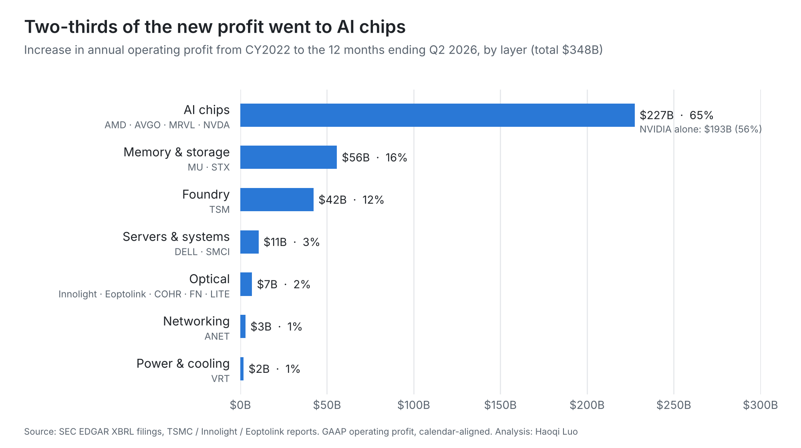
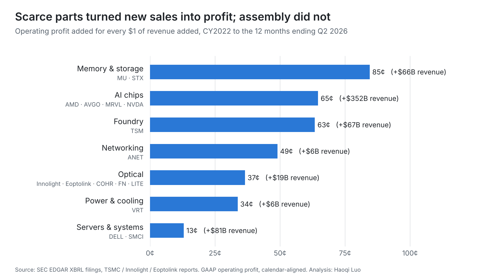
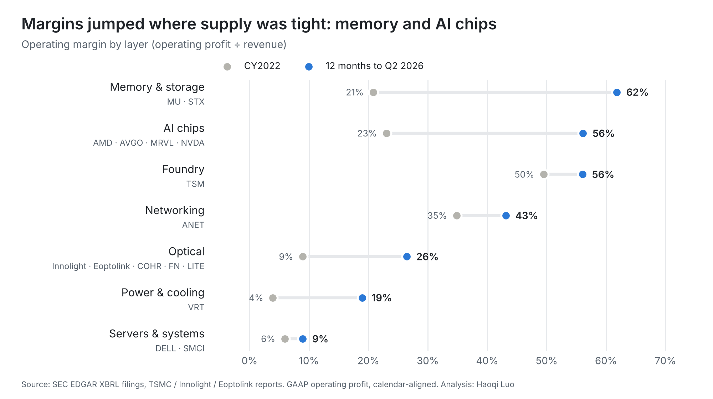
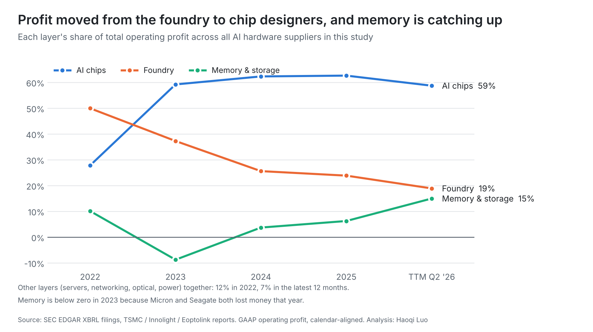
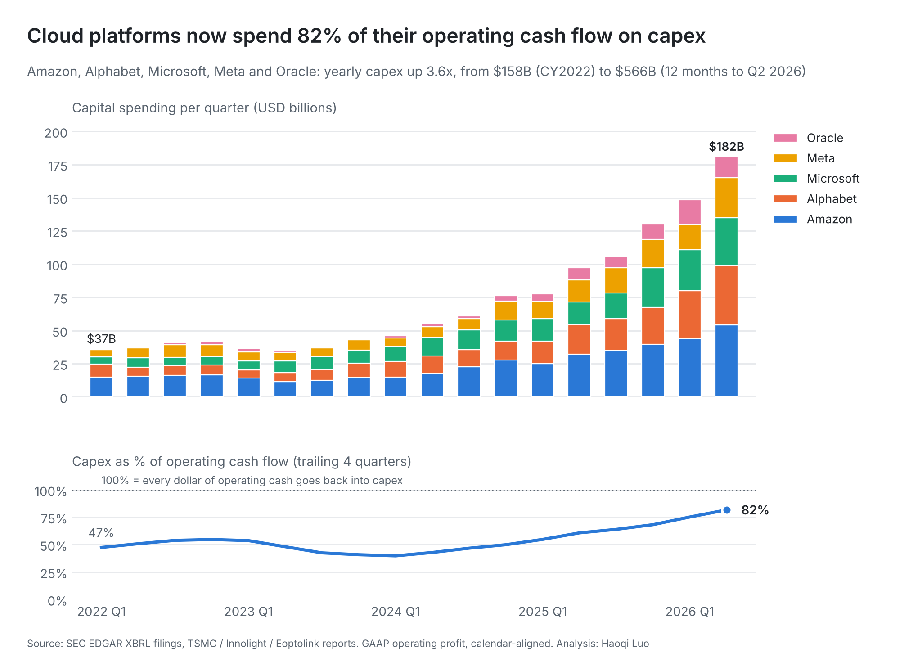

# AI Infrastructure Value Chain: Where Does the Profit Land?

[English](README.md) · [中文](README.zh-CN.md)

Cloud platforms are spending record amounts on AI data centers. This project follows that money down the hardware supply chain (servers, chips, foundry, memory, networking, optical, power) and uses company filings to answer one question: **which layer actually keeps the profit?**

**Independent industry analysis, not investment advice.** 21 companies · CY2022 vs. the 12 months ending Q2 2026 · data from SEC EDGAR and company reports, pulled October 2026.

<picture>
  <source media="(prefers-color-scheme: dark)" srcset="charts/dark/1_new_profit_by_layer.png">
  
</picture>

## Short answer

1. **Profit follows scarcity, not volume.** Since 2022 the AI hardware suppliers in this study added **$348B** of yearly operating profit. **94%** of it landed in three layers where supply was tight: AI chips (65%), memory (16%) and the foundry (12%). **NVIDIA alone took 56%.**
2. **Assembly moves the most boxes but keeps little.** Server makers added $81B of revenue but only $11B of operating profit: **13¢ per new dollar**, versus 85¢ in memory and 65¢ in AI chips.
3. **Profit is rotating inside the chain.** The foundry's share of supplier profit fell from 50% to 19% while chip designers rose from 28% to 59%. Memory had the biggest margin jump of any layer (21% → 62%) and is now the fastest-rising share.
4. **The buyers are using almost all of their cash.** The five cloud platforms in this study raised capex **3.6x** to $566B a year, now **82% of their operating cash flow** (55% in 2022). Their operating cash flow grew by $404B, and capex grew by $409B.

## How the chain fits together

| Layer | What it sells into an AI data center | Companies in this study |
| --- | --- | --- |
| Cloud & AI platforms (buyers) | Pay for the data centers (capex) | Amazon, Alphabet, Microsoft, Meta, Oracle |
| Servers & systems | Assemble GPUs, memory and networking into racks | Dell, Super Micro |
| AI chips | GPUs and custom accelerators (ASICs) | NVIDIA, Broadcom, AMD, Marvell |
| Foundry | Manufactures the chips, plus advanced packaging | TSMC |
| Memory & storage | HBM / DRAM for accelerators, hard drives for data | Micron, Seagate |
| Networking | Ethernet switches that connect GPU clusters | Arista |
| Optical | Optical modules and lasers between racks | Innolight (中际旭创), Eoptolink (新易盛), Coherent, Lumentum, Fabrinet |
| Power & cooling | Power and liquid cooling equipment | Vertiv |

## Findings

### 1. Scarce parts turned new sales into profit; assembly did not

<picture>
  <source media="(prefers-color-scheme: dark)" srcset="charts/dark/2_profit_per_new_dollar.png">
  
</picture>

Revenue grew in every layer, so revenue growth alone does not show who wins. The useful question is how much of each new dollar of sales stayed as profit. Layers that control a bottleneck (HBM supply, leading-edge wafers, the GPU itself) kept 63¢ to 85¢. Server assembly kept 13¢, and Super Micro's margin actually fell (10% → 7%) while its revenue grew almost 6x.

### 2. Margins jumped where supply was tight

<picture>
  <source media="(prefers-color-scheme: dark)" srcset="charts/dark/3_margin_shift.png">
  
</picture>

Every layer improved, but by very different amounts. NVIDIA went from a 16% to a 65% operating margin, and Micron from 25% to 66%. TSMC was already very profitable in 2022, so its margin moved less even though its profit grew by $42B.

### 3. Profit is rotating: from the foundry to chip designers, and now to memory

<picture>
  <source media="(prefers-color-scheme: dark)" srcset="charts/dark/4_profit_share_over_time.png">
  
</picture>

In 2022 TSMC alone earned half of this group's operating profit. By 2023 chip designers had taken the top spot, and they peaked at 63% in 2025. In the latest 12 months memory is the fastest riser, up from a loss in 2023 to 15% of the group's profit.

### 4. Who pays: cloud platforms now reinvest 82% of their operating cash

<picture>
  <source media="(prefers-color-scheme: dark)" srcset="charts/dark/5_cloud_capex.png">
  
</picture>

| Five cloud platforms | CY2022 | 12 months to Q2 2026 |
| --- | ---: | ---: |
| Capex | $158B | $566B |
| Operating cash flow | $288B | $692B |
| Capex ÷ operating cash flow | 55% | 82% |
| Cash left after capex | $130B | $126B |

Their businesses generate far more cash than in 2022, but all of the increase is going back into data centers. Oracle has gone furthest: its capex is 174% of its operating cash flow, so the gap has to be funded from outside.

### 5. Optical: fast growth, small profit pool, led by China's module makers

Optical is one of the fastest-growing layers (revenue 2.7x), but it is still only 2% of the new profit. Inside the layer, the two Chinese module makers captured **82%** of the new profit:

| Optical group | New revenue | New operating profit | Operating margin (latest 12 months) |
| --- | ---: | ---: | ---: |
| Innolight + Eoptolink (module makers) | +$12.5B | +$5.5B | 41% |
| Coherent + Lumentum + Fabrinet (components, contract manufacturing) | +$6.0B | +$1.2B | 12% |

## My read

- **Where profit lands depends on who holds the bottleneck.** The layers with pricing power (GPUs, HBM, leading-edge wafers) captured most of the profit. Layers that compete on assembly and delivery (servers) grew revenue with thin margins.
- **The money flows down the chain, but the risk flows back up.** Cloud capex is now close to the limit of what existing cash flow can pay for. The next step of growth needs either AI revenue at the cloud platforms or more borrowing (Oracle is already there). If capex growth slows, the layers that gained the most profit (chips and memory) also have the most to give back, and memory has the most cyclical history (it lost money as recently as 2023).
- **What I would watch next:** (1) capex as a share of operating cash flow approaching 100%; (2) custom chips from Broadcom and Marvell taking share of the chip layer's profit from NVIDIA; (3) whether memory margins are a new level or a cycle peak; (4) whether optical moves from "fast growth" to a larger share of profit as clusters grow.

## Layer summary

USD billions. "Latest" = 12 months ending Q2 2026.

| Layer | Revenue 2022 | Revenue latest | Growth | Operating margin | New operating profit | Share of new profit | Profit per new $1 of revenue | Capex ÷ revenue (latest) |
| --- | ---: | ---: | ---: | :---: | ---: | ---: | ---: | ---: |
| AI chips | 91 | 443 | 4.9x | 23% → 56% | +227 | 65% | 65¢ | 2% |
| Memory & storage | 37 | 102 | 2.8x | 21% → 62% | +56 | 16% | 85¢ | 25% |
| Foundry | 76 | 143 | 1.9x | 50% → 56% | +42 | 12% | 63¢ | 34% |
| Servers & systems | 109 | 190 | 1.7x | 6% → 9% | +11 | 3% | 13¢ | 2% |
| Optical | 11 | 29 | 2.7x | 9% → 26% | +7 | 2% | 37¢ | 10% |
| Networking | 4 | 11 | 2.4x | 35% → 43% | +3 | 1% | 49¢ | 1% |
| Power & cooling | 6 | 11 | 2.0x | 4% → 19% | +2 | 1% | 34¢ | 4% |

<details>
<summary><b>Company detail (21 companies)</b></summary>

| Company | Layer | Revenue 2022 | Revenue latest | Growth | Op. margin 2022 | Op. margin latest | New operating profit |
| --- | --- | ---: | ---: | ---: | ---: | ---: | ---: |
| Amazon | Cloud & AI platforms | 514.0 | 775.7 | 1.5x | 2% | 12% | +81.5 |
| Alphabet | Cloud & AI platforms | 282.8 | 445.9 | 1.6x | 26% | 33% | +72.8 |
| Microsoft | Cloud & AI platforms | 204.1 | 331.8 | 1.6x | 41% | 47% | +72.4 |
| Meta Platforms | Cloud & AI platforms | 116.6 | 228.2 | 2.0x | 25% | 38% | +58.0 |
| Oracle | Cloud & AI platforms | 46.1 | 67.4 | 1.5x | 30% | 31% | +6.6 |
| Dell Technologies | Servers & systems | 102.3 | 151.2 | 1.5x | 6% | 9% | +8.5 |
| Super Micro Computer | Servers & systems | 6.6 | 39.1 | 5.9x | 10% | 7% | +2.1 |
| NVIDIA | AI chips | 27.0 | 303.0 | 11.2x | 16% | 65% | +193.4 |
| Broadcom | AI chips | 34.4 | 89.1 | 2.6x | 44% | 48% | +27.6 |
| Advanced Micro Devices | AI chips | 23.6 | 41.3 | 1.8x | 5% | 16% | +5.2 |
| Marvell Technology | AI chips | 5.9 | 9.5 | 1.6x | 4% | 17% | +1.3 |
| TSMC | Foundry | 76.0 | 142.6 | 1.9x | 50% | 56% | +42.3 |
| Micron Technology | Memory & storage | 27.2 | 90.3 | 3.3x | 25% | 66% | +52.4 |
| Seagate Technology | Memory & storage | 9.4 | 12.2 | 1.3x | 8% | 34% | +3.4 |
| Arista Networks | Networking | 4.4 | 10.5 | 2.4x | 35% | 43% | +3.0 |
| Innolight (中际旭创) | Optical | 1.4 | 9.4 | 6.5x | 14% | 40% | +3.5 |
| Eoptolink (新易盛) | Optical | 0.5 | 5.1 | 10.3x | 31% | 43% | +2.0 |
| Coherent | Optical | 4.4 | 7.1 | 1.6x | 6% | 12% | +0.6 |
| Lumentum | Optical | 1.8 | 3.0 | 1.6x | 5% | 17% | +0.4 |
| Fabrinet | Optical | 2.5 | 4.6 | 1.9x | 10% | 10% | +0.2 |
| Vertiv | Power & cooling | 5.7 | 11.5 | 2.0x | 4% | 19% | +2.0 |

Full tables: [`outputs/company_summary.csv`](outputs/company_summary.csv), [`outputs/layer_summary.csv`](outputs/layer_summary.csv)
</details>

## Method

- **Why operating profit, not revenue.** Revenue is counted more than once along a supply chain: NVIDIA's sales include TSMC's wafers and Micron's memory, and Dell's sales include NVIDIA's GPUs. Operating profit is not double counted, because each company only keeps its own margin. So "who makes the money" is measured with GAAP operating profit, and revenue is used for growth and margins.
- **Periods.** CY2022 is the baseline (ChatGPT launched on Nov 30, 2022). "Latest" is the 12 months ending in calendar Q2 2026, the latest quarter every company had reported.
- **Calendar alignment.** Fiscal years end in different months (NVIDIA in January, Microsoft in June, Micron in August). US companies also report year-to-date numbers, so each standalone quarter is rebuilt (for example Q4 = full year minus nine months) and mapped to the calendar quarter where most of it falls. Four calendar quarters are then added up.
- **Two measures of "who wins".** Share of new profit = a layer's increase in operating profit ÷ the increase across all suppliers. Profit per new dollar = increase in operating profit ÷ increase in revenue.
- **Currency.** TSMC (TWD) and the two China-listed companies (CNY) are converted at the average exchange rate of each period (Federal Reserve G.5A and FRED monthly rates).

**Data checks** (printed every time the pipeline runs):
- Rebuilt quarters add back to the reported fiscal year: 588 fiscal years checked, 0 off by more than 0.5%.
- TSMC figures typed from annual reports match the 20-F XBRL facts exactly.
- Spot checks against earnings releases: NVIDIA Q2 FY27 revenue $96.2B, Micron FQ3 FY26 revenue $41.46B and operating income $33.32B, Dell Q2 FY27 revenue $47.0B.

## Limitations

- **Company totals, not AI-only segments.** Dell includes PCs, AMD includes PC and gaming chips, Broadcom includes VMware software, Micron includes phone and PC memory. The trend is driven by AI, but not every dollar is AI.
- **Acquisitions lift growth for some companies:** AMD + Xilinx (2022), Broadcom + VMware (late 2023), II-VI + Coherent (2022). GAAP operating profit also includes acquisition amortization, which lowers margins for Broadcom, AMD and Coherent.
- **Missing companies.** SK hynix and Samsung (the largest HBM suppliers) and Taiwanese server makers (Foxconn, Quanta, Wiwynn) are not included because they do not file comparable statements with the SEC. On the buyer side, neoclouds (such as CoreWeave) and AI labs (such as OpenAI) are not counted.
- **Capex excludes finance leases**, which are large for Microsoft, Amazon and Oracle, so true data-center spending is higher than shown.
- **China-listed companies** use "operating profit" (营业利润) under Chinese accounting standards, which also includes investment income.
- Three Lumentum quarters missing from SEC XBRL were filled from its earnings releases ([`data/manual/sec_gap_fills.csv`](data/manual/sec_gap_fills.csv)).

## Data sources

| Data | Source |
| --- | --- |
| US filers (18) | [SEC EDGAR XBRL companyfacts API](https://www.sec.gov/search-filings/edgar-application-programming-interfaces), free, no key |
| TSMC | 20-F XBRL (2022-2024) and quarterly management reports (2025-2026) |
| Innolight, Eoptolink | Annual and interim reports (via Sina Finance / Eastmoney F10) |
| Exchange rates | Federal Reserve G.5A annual averages, FRED monthly rates |

Every manually entered number is in [`data/manual/`](data/manual/) with its source.

## Run it yourself

```bash
pip install -r requirements.txt
python src/fetch_sec_data.py   # 1. download filings from SEC EDGAR (about 1 minute)
python src/build_dataset.py    # 2. rebuild quarters, calendar-align, add TTM
python src/analyze.py          # 3. layer and company summaries -> outputs/
python src/make_charts.py      # 4. charts -> charts/light and charts/dark
```

SEC asks for a contact in the request header; set `SEC_USER_AGENT="Your Name your@email.com"` before step 1. A GitHub Actions workflow runs the same four steps and commits refreshed data and charts.

```
config/companies.csv      companies, value-chain layer, SEC CIK
data/raw/                 facts as reported to the SEC
data/manual/              TSMC, China-listed companies, exchange rates, gap fills (with sources)
data/processed/           calendar quarters and periods (USD billions)
outputs/                  summary tables used in this README
charts/                   light and dark versions of every chart
src/                      the four pipeline steps
```

---

Independent project by Haoqi Luo. I set the question, the value-chain scope and the company list, and reviewed the data checks and conclusions; AI tools assisted with the code, data processing and drafting. This is industry analysis, not a recommendation to buy or sell any security.
